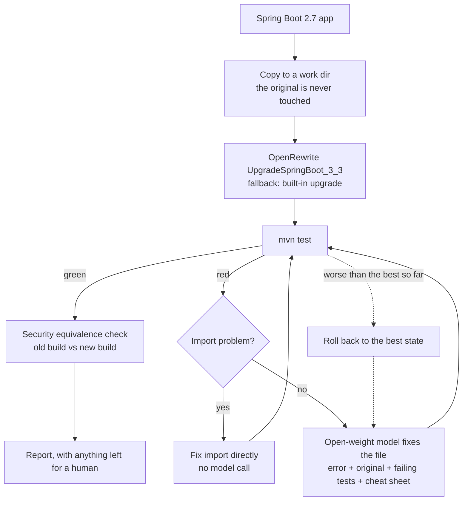

# Boot Upgrade Agent

[](https://github.com/Ishika-eng/Hacktoberfest_26/actions/workflows/ci.yml)

An agent that upgrades a **Spring Boot 2.7** app to **Spring Boot 3** with a local **open-weight** model, then checks that the upgrade did not silently change who can access what.

Built for the *Best Open-Source AI Project* challenge at Hacktoberfest 2026 (project type: **model harness**).

## The problem

Many companies still run Spring Boot 2.x, which no longer gets open-source security fixes. Upgrading to Boot 3 breaks code (`javax` to `jakarta`, removed APIs such as `WebSecurityConfigurerAdapter`) and, worse, can silently change security behaviour. Automated tools handle the mechanical changes, but engineers spend weeks on the leftovers and on verifying that nothing was exposed, so upgrades keep getting postponed.

## The solution

The agent runs OpenRewrite first, then builds and tests. It sends each compile error or test failure, with the relevant code, to an open-weight model, applies the fix and retests, up to a few attempts. It then replays the same HTTP requests against the old and the new build, as anonymous, user and admin, and flags every endpoint whose answer changed. Anything it cannot fix is flagged for a human, with a model-written diagnosis. The output is a Boot 3 app and a report of what changed and why.

**Why open-weight:** the model runs on the company's own machine, so proprietary code never leaves it.

## What is implemented

| Capability | Status |
|---|---|
| OpenRewrite `UpgradeSpringBoot_3_3` first, with a small built-in fallback if it fails | Done |
| Build and test loop; the model fixes files from compile errors, test failures and Spring startup failures | Done |
| Deterministic import repair (wrong, missing or unused imports) before spending a model call | Done |
| Test-integrity guard: the agent can only write under `src/main`; every file under `src/test` (tests and resources) and every `pom.xml` / `.mvn` file is hashed; new `skipTests`, `maven.test.skip`, `testFailureIgnore` or surefire excludes are rejected; the upgraded app must execute exactly the tests the Boot 2 original ran | Done |
| Regression rollback: a round that scores worse is reverted, and a rejected attempt is shown to the model so it does not repeat it | Done |
| Reject model replies that answer about the wrong file | Done |
| Per-round prompts and replies saved to `runs/` | Done |
| Security equivalence check: same requests as anonymous / user / admin against the old and new build. Separates *denied* (401/403) from *not found* (404), lists what each change means and puts newly accessible requests first | Done, for the endpoints listed in the app's `endpoints.json` (not auto-discovered) |
| OSV advisory counts before and after, with the list of what remains (`--cve-scan`) | Done, opt-in. These are advisories for exact versions, not confirmed CVEs, and the agent does not bump dependencies itself |
| Model-written diagnosis for failures and security differences | Done; labelled unverified |
| Java 17+ check with a clear error | Done |
| Two sample apps, one held-out third-party app (spring-petclinic, pinned commit) and a benchmark that records hardware, Ollama version, model quantization, sampling settings and whether repeated runs produced identical code ([BENCHMARK.md](BENCHMARK.md)) | Done |
| Gradle support | Not yet |
| Auto-discovering endpoints for the security check | Not yet |
| Demo video | Not yet |

## How it works



The model sees only the failing file, its original version, the errors for that file, the failing tests and the cheat sheet in [`agent/cheatsheet/`](agent/cheatsheet) (one file per topic), never the whole repo.

## Results

Measured on an 18 GB Apple Silicon laptop with everything local (Ollama). Three runs per model per app (DeepSeek was stopped early, see below); the full table, hardware and per-run reports are in [BENCHMARK.md](BENCHMARK.md) and [`reports/benchmark/`](reports/benchmark).

| App | Setup | Runs passed | Tests passed | Model rounds | Time per run | Security differences |
|---|---|---|---|---|---|---|
| `sample-app` (11 tests) | OpenRewrite alone | 0/1 | does not compile | 0 | 11 s | n/a |
| `sample-app` | **Qwen2.5-Coder 7B + agent** | **3/3** | 11/11 each run | 2 | 62–65 s | 0 of 18 checks |
| `sample-app` | DeepSeek-Coder 6.7B + agent | 0/2 | 8/11, 8/11 | 5 | 260 s and 863 s | 10 of 18 checks, both runs |
| `sample-jpa-app` (8 tests) | OpenRewrite alone | 0/1 | does not compile | 0 | 11 s | n/a |
| `sample-jpa-app` | **Qwen2.5-Coder 7B + agent** | **3/3** | 8/8 each run | 1 | 65–67 s | 2 of 24 checks, the same 2 every run |
| `sample-jpa-app` | DeepSeek-Coder 6.7B + agent | 0/1 | 3/8 | 5 | 223 s | 16 of 24 checks |

What this shows:

- **OpenRewrite alone is not enough.** It converts the `javax` imports and most of the security chain, but it cannot rewrite `WebSecurityConfigurerAdapter` (it leaves a "migrate manually" marker) or Hibernate 6's removed `@Type(type=...)`. Neither sample app compiles afterwards, so no tests run.
- **With the agent, Qwen2.5-Coder 7B finishes both upgrades** in about a minute, passing every test, in all six runs. It rewrites the security config into a `SecurityFilterChain` bean (plus the user store and `AuthenticationManager` bean in `sample-app`) and replaces the `@Type` mapping in `sample-jpa-app`.
- **Green tests are not the whole story.** On `sample-jpa-app` all 8 tests pass, yet `GET /products/` (with a trailing slash) goes from **200 to 404** for logged-in users, because Spring 6 stopped matching trailing slashes. No test covers it. The security equivalence check finds it every time and the report flags it for a human instead of reporting a clean pass.

| Endpoint (`sample-jpa-app`) | anonymous | clerk | manager |
|---|---|---|---|
| `GET /products` | 401 | 200 | 200 |
| `GET /products/` | 401 | **200 → 404** | **200 → 404** |

**DeepSeek-Coder 6.7B did not finish either app, and its benchmark was stopped early on purpose.** After two runs on `sample-app` (both 8/11) and one on `sample-jpa-app` (3/8) it was clearly not converging, and each run takes 4 to 14 minutes, so the remaining runs were skipped. The three finished runs are reported above as they came out. Its upgraded apps answer 10 of 18 and 16 of 24 requests differently from the Boot 2.7 build (requests that used to give 200 or 401 now give 403), so the security check confirms what the failing tests show.

Do not read this as "DeepSeek cannot do it". There are two causes. The model rewrites the security config with `httpBasic(AbstractHttpConfigurer::disable)`, which turns HTTP Basic off. And there is a **known weakness in the agent that is not fixed**: when the build compiles but tests fail, it picks the files to fix from the stack trace. DeepSeek's later rounds went to `ApiController`, `DemoApplication`, `Order` and `ShopApplication`, which were not the problem, and it never got another chance at `SecurityConfig`. Fixing that file choice is the first thing to try, and the Qwen numbers would need rerunning with it.

How to read these results fairly:

- The harness was tuned after watching models fail on these two apps. An earlier benchmark run had Qwen fail `sample-jpa-app` after writing one class into another file's source. That led to per-file error messages and the check that rejects a reply for the wrong file. The numbers above are after those changes, so they measure the harness plus the model, and the cheat sheet entries target exactly these apps.
- Three runs per cell is a small sample, and models are not perfectly repeatable even at temperature 0.
- Two small apps are not your codebase. Treat this as evidence that the approach works, not as a guarantee.

## Held-out test

Both sample apps and the cheat sheet were written by us, so they could be tuned to each other. To check, the benchmark also includes an app we did not write: the Spring team's own [spring-petclinic](https://github.com/spring-projects/spring-petclinic) at commit `a5cbb85` (Spring Boot 2.7.3, Apache-2.0), pinned and fetched on demand instead of copied into this repo. The cheat sheet was frozen before its first run, and the results are reported as they came out. Details and rules: [`agent/heldout/README.md`](agent/heldout/README.md). Petclinic has no Spring Security, so it tests the upgrade and Hibernate/JPA side, not access control.

HELDOUT_RESULTS_PLACEHOLDER

## Safety

- The agent works on a **copy**; your original app is never modified.
- **It cannot make the tests easier.** First it runs the original app's tests, which must pass, and records how many ran. After the upgrade, a run only counts as a pass if the same number of tests ran and passed (a skipped test is not a pass). Writes are limited to `src/main`; everything under `src/test` (tests and test resources) and every `pom.xml` and `.mvn` file is hashed after the upgrade tool runs and again at the end; and a pom that gains `skipTests`, `maven.test.skip`, `testFailureIgnore` or surefire excludes is rejected. Any of these makes the run exit with code 2 and the report says `INVALID`. If the upgrade tool itself rewrites a test file, the report lists it.
- **Every output needs human review.** Passing tests only proves what the tests cover. The security check only covers the endpoints and roles you list.
- The security check says what each change means. A request that used to work and now returns **404** is a route that no longer matches, which is a different problem from one that now returns **403** (access removed). A request that was denied or missing and is now **allowed** is listed first as a possible exposure.
- `--cve-scan` is opt-in because it sends dependency names and versions (not source code) to api.osv.dev. The numbers are OSV advisories, not confirmed CVEs, and many may not affect your app. The agent does not bump dependencies, so the report lists the advisories that remain after the upgrade.
- The model's diagnosis is generated text and is labelled unverified in the report.

## Models used

| Model | Run through | Licence | Model card |
|---|---|---|---|
| Qwen2.5-Coder 7B Instruct (`qwen2.5-coder:7b-instruct`) | Ollama | [Apache 2.0](https://huggingface.co/Qwen/Qwen2.5-Coder-7B-Instruct/blob/main/LICENSE) (open source) | [Hugging Face](https://huggingface.co/Qwen/Qwen2.5-Coder-7B-Instruct) |
| DeepSeek-Coder 6.7B (`deepseek-coder:6.7b`) | Ollama | [DeepSeek License Agreement v1.0](https://github.com/deepseek-ai/deepseek-coder/blob/main/LICENSE-MODEL) (open-weight, not open source) | [Hugging Face](https://huggingface.co/deepseek-ai/deepseek-coder-6.7b-instruct) |

- **Qwen2.5-Coder** is under the standard Apache 2.0 licence: commercial use and redistribution are allowed with the usual notices.
- **DeepSeek-Coder** is open-weight under a custom licence. Commercial use is allowed, but the licence has use restrictions (for example no military use and no harmful or fully automated decisions) that must be passed on to anyone you redistribute the model or derivatives to. It is governed by PRC law.
- Licence details were read from the model cards on 22 Oct 2026 (card pages and licence texts); re-check them before redistributing weights. The cards describe the Hugging Face Instruct models; we run the Ollama tags above and have not checked that they are byte-identical to those releases.

The model is a setting (`--model` or `MODEL=...`), and any OpenAI-compatible endpoint can be used instead with `OPENAI_BASE_URL`.

## Run it

You need JDK 17+, Maven, Python 3.10+ (standard library only) and [Ollama](https://docs.ollama.com/quickstart).

```bash
ollama pull qwen2.5-coder:7b-instruct

# baseline: the Spring Boot 2.7 sample app passes its own tests
(cd sample-app && mvn test)

# upgrade it (copies to migrated-sample-app/, writes REPORT.md)
python3 agent/migrate.py sample-app

# the second sample app (JPA, Hibernate, Actuator)
python3 agent/migrate.py sample-jpa-app --model deepseek-coder:6.7b

# useful flags
python3 agent/migrate.py sample-app --max-attempts 0          # upgrade tool only, no model
python3 agent/migrate.py sample-app --no-openrewrite          # built-in fallback upgrade
python3 agent/migrate.py sample-app --cve-scan                # also count known advisories
python3 agent/migrate.py --help
```

Exit codes: `0` upgraded and equivalent, `1` could not finish (flagged for a human), `2` test files were modified (run invalid), `3` tests pass but security behaviour differs.

Point it at your own app with `python3 agent/migrate.py /path/to/app`. To get the security check, add an `endpoints.json` next to its `pom.xml` (see [`sample-app/endpoints.json`](sample-app/endpoints.json)). If `mvn` is not on your PATH, set `MVN=/path/to/mvn`.

Run the agent's own tests (no Ollama or Maven needed) and the benchmark:

```bash
python3 -I -m unittest discover -s agent/tests -t agent
python3 agent/bench.py

# fetch the held-out app and upgrade it
python3 agent/heldout.py
python3 agent/migrate.py heldout/spring-petclinic --endpoints agent/heldout/spring-petclinic.endpoints.json
```

## Layout

| Path | What it is |
|---|---|
| `agent/migrate.py` | The agent |
| `agent/cheatsheet/` | Migration notes given to the model, one file per topic |
| `agent/securitydiff.py` | Security equivalence check |
| `agent/cves.py` | Optional advisory scan |
| `agent/bench.py` | Benchmark runner that writes `BENCHMARK.md` |
| `agent/heldout.py`, `agent/heldout/` | Fetches the held-out app at its pinned commit; its endpoint spec and rules |
| `agent/tests/` | Unit tests with a mocked model and build |
| `sample-app/`, `sample-jpa-app/` | Spring Boot 2.7 sample apps with tests and `endpoints.json` |
| `reports/` | Reports and per-round logs from the runs described above |
| `BENCHMARK.md` | The benchmark table |

## Limitations

- Two small sample apps. Results on your codebase will differ.
- The model sizes tested are 6–7B. They handle the common Spring Security rewrite and Hibernate 6 `@Type` change, but results vary between runs and a failed run is expected, which is why every failure is reported and flagged.
- When tests fail at runtime the agent can pick the wrong file to fix (see Results). This hurt the weaker model in every one of its runs.
- The cheat sheet and import table were extended after watching models fail on these sample apps, so the pass rates measure the harness plus those hints, not unaided models.
- The security check compares HTTP status codes for the endpoints you list; it does not read your security configuration.
- Maven only; the agent does not patch vulnerable dependencies itself beyond what the Boot 3 upgrade brings.

## Contributing

See [CONTRIBUTING.md](CONTRIBUTING.md). The easiest contributions are a cheat sheet entry, a new sample app or a new model in the benchmark.

## Licence

MIT, see [LICENSE](LICENSE).
