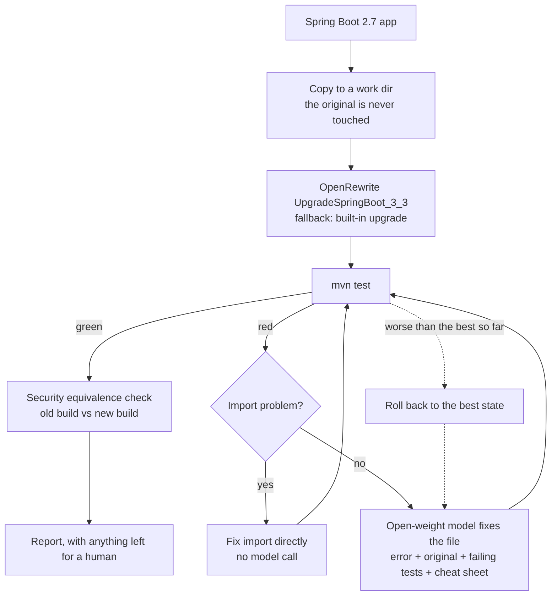

# Boot Upgrade Agent

[](https://github.com/Ishika-eng/Hacktoberfest_26/actions/workflows/ci.yml)

An agent that upgrades a **Spring Boot 2.7** app to **Spring Boot 3** with a local **open-weight** model, then checks that the upgrade did not silently change who can access what.

Built for the *Best Open-Source AI Project* challenge at Hacktoberfest 2026 (project type: **model harness**).

## The problem

Many companies still run Spring Boot 2.x, which no longer gets open-source security fixes. Upgrading to Boot 3 breaks code (`javax` to `jakarta`, removed APIs such as `WebSecurityConfigurerAdapter`) and, worse, can silently change security behaviour. Automated tools handle the mechanical changes, but engineers spend weeks on the leftovers and on verifying that nothing was exposed, so upgrades keep getting postponed.

## The solution

The agent runs OpenRewrite first, then builds and tests. It sends each compile error or test failure, with the relevant code, to an open-weight model, applies the fix and retests, up to a few attempts. It then replays the same HTTP requests against the old and the new build, as anonymous, user and admin, and flags every endpoint whose answer changed. Anything it cannot fix is flagged for a human, with a model-written diagnosis. The output is a Boot 3 app and a report of what changed and why.

**Why open-weight:** the model runs on the company's own machine, so proprietary code never leaves it.

## What is implemented

| Capability | Status |
|---|---|
| OpenRewrite `UpgradeSpringBoot_3_3` first, with a small built-in fallback if it fails | Done |
| Build and test loop; the model fixes files from compile errors, test failures and Spring startup failures | Done |
| Deterministic repairs before an attempt is judged and before a model call: wrong, missing or unused imports (including common JPA, validation and servlet classes) and an `@Override` the compiler rejects | Done |
| Test-integrity guard: the agent can only write under `src/main`; every file under `src/test` (tests and resources) and every `pom.xml` / `.mvn` file is hashed; new `skipTests`, `maven.test.skip`, `testFailureIgnore` or surefire excludes are rejected; the upgraded app must execute exactly the tests the Boot 2 original ran | Done |
| Regression rollback: a round that scores worse is reverted, and a rejected attempt is shown to the model so it does not repeat it | Done |
| Reject model replies that answer about the wrong file | Done |
| Per-round prompts and replies saved to `runs/` | Done |
| Security equivalence check: same requests as anonymous / user / admin against the old and new build. Separates *denied* (401/403) from *not found* (404), lists what each change means and puts newly accessible requests first | Done, for the endpoints listed in the app's `endpoints.json` (not auto-discovered) |
| OSV advisory counts before and after, with the list of what remains (`--cve-scan`) | Done, opt-in. These are advisories for exact versions, not confirmed CVEs, and the agent does not bump dependencies itself |
| Model-written diagnosis for failures and security differences | Done; labelled unverified |
| Java 17+ check with a clear error | Done |
| Two sample apps, one held-out third-party app (spring-petclinic, pinned commit) and a benchmark that records hardware, Ollama version, model quantization, sampling settings and whether repeated runs produced identical code ([BENCHMARK.md](BENCHMARK.md)) | Done |
| Gradle support | Not yet |
| Auto-discovering endpoints for the security check | Not yet |
| Demo video | Not yet |

## How it works



The model sees only the failing file, its original version, the errors for that file, the failing tests and the cheat sheet in [`agent/cheatsheet/`](agent/cheatsheet) (one file per topic), never the whole repo.

## Results

Measured on an Apple M3 Pro with 18 GB RAM, everything local (Ollama 0.40.3, Qwen2.5-Coder 7B at Q4_K_M, temperature 0, seed 0). Full table, model details, agent commit and per-run reports: [BENCHMARK.md](BENCHMARK.md) and [`reports/benchmark/`](reports/benchmark).

**This benchmark is incomplete and partly negative. Please read it as it is.** Earlier numbers in this repository were wrong: a bug made the agent silently use its weak built-in fallback instead of OpenRewrite (OpenRewrite skips folders that a `.gitignore` ignores). That is fixed, those numbers were removed, and the rows below are the corrected ones. DeepSeek-Coder has not been rerun with the corrected setup, so it has no result here.

| App | Setup | Runs passed | Tests passed | Time per run | Security answers that changed |
|---|---|---|---|---|---|
| `sample-app` (11 tests) | OpenRewrite alone | 0/1 | does not compile | 12 s | n/a |
| `sample-app` | **OpenRewrite + agent (Qwen2.5-Coder 7B)** | **3/3** | 11/11 each run | 45 s | 0 of 18 |
| `sample-jpa-app` (8 tests) | OpenRewrite alone | 0/1 | does not compile | 21 s | n/a |
| `sample-jpa-app` | **OpenRewrite + agent (Qwen2.5-Coder 7B)** | **3/3** | 8/8 each run | 51 s | 2 of 24 |

The two apps we did not write are in the next section (Held-out tests).

What this shows:

- **OpenRewrite alone is not enough.** It converts the security rules but cannot rewrite `WebSecurityConfigurerAdapter` (it leaves a "migrate manually" marker), and on the JPA app it rewrote Hibernate's `@Type(type = "text")` into `@Type(text.class)`, which does not compile. Neither of our apps builds afterwards.
- **With the agent, Qwen finishes both of our apps.** `sample-app`: all 11 tests in 45 seconds, and all 18 security checks answer the same as the Boot 2.7 build. `sample-jpa-app`: all 8 tests in 51 seconds. In both, the generated code is byte-identical in all three runs, so each is one result seen three times, not three independent samples.
- **Green tests are not the whole story.** On `sample-jpa-app` all 8 tests pass, yet `GET /products/` changes from **200 to 404** for logged-in users (Spring 6 stopped matching trailing slashes). No test covers it. The security check reports it as "route no longer matches", separately from access being removed, and puts anything newly accessible first.
- **The JPA pass came after a fix made while looking at these results.** Before it, Qwen failed `sample-jpa-app` 3 of 3: the model's rewrite was right but missed an import and left a stale `@Override`, so the attempt scored worse and was rolled back. The agent now repairs those slips (known imports, an `@Override` the compiler rejects) before judging an attempt, and the runs were repeated. Because the change was made after seeing the failure, the pass is not an independent test of it. The single early hand-run that passed this app before the failures is consistent with the model being able to do it.

Fairness notes: the cheat sheet, import table and repairs were extended after watching models fail on these two apps, so passes measure the harness plus those hints. Three runs per cell is a small sample, and where the code is identical across runs it is really one sample. Two small apps are not your codebase.

## Held-out tests

Both sample apps and the cheat sheet were written by us, so they could be tuned to each other. To check, we also ran apps we did not write: the Spring team's own [spring-petclinic](https://github.com/spring-projects/spring-petclinic) and [spring-petclinic-rest](https://github.com/spring-petclinic/spring-petclinic-rest) (both Apache-2.0), pinned to a commit and fetched on demand instead of copied into this repo. The cheat sheet was frozen before the first run on each. Rules and pins: [`agent/heldout/README.md`](agent/heldout/README.md).

**spring-petclinic (Boot 2.7.3; JPA, Thymeleaf, caching, Actuator, no Spring Security)**
- *First run (agent as it was, genuinely held-out): FAIL.* OpenRewrite crashed because the project has both a `pom.xml` and a `build.gradle` and the plugin tried to download Gradle. The weak fallback then left `mysql:mysql-connector-java` (renamed in Boot 3) in the pom, so the build could not even load. The agent edits Java only, so it could not fix that.
- *After we made the agent ignore Gradle files in a Maven project's work copy: PASS.* 41 tests ran and 40 passed, exactly as in the Boot 2 baseline, with **0 model rounds**: OpenRewrite alone was enough here, so the model was not used. **This second result is not held-out**, because we changed the agent after seeing the first failure. Report: [`reports/history/petclinic-after-gradle-fix/`](reports/history/petclinic-after-gradle-fix/run.md).

**spring-petclinic-rest (Boot 2.6.2; Spring Security, code generated from an OpenAPI file) — run once, untuned: FAIL.**
- The original passes all 172 of its tests and OpenRewrite runs, but the upgraded build then has 100 compile errors, **all in code generated at build time** (`target/generated-sources/openapi`), because the generator is still configured to emit `javax.*`. The fix belongs in `pom.xml` (the generator's settings), not in Java sources the agent may edit, so the agent stopped without calling the model and flagged it for a human.
- The report's model-written diagnosis was **wrong**: it suggested adding `javax.validation` dependencies instead of reconfiguring the generator. That is why diagnoses are labelled unverified. Report: [`reports/history/second-heldout-petclinic-rest/`](reports/history/second-heldout-petclinic-rest/run.md).

**What this says about unseen code:** one of the two apps upgrades (without needing the model), and the other fails for a reason outside what the agent is allowed to change. On unseen code the agent's value so far is that it **verifies** the result and **fails safely**, not that the model generalises. We have no evidence yet that the model fixes code it was not tuned on.

## Safety

- The agent works on a **copy**; your original app is never modified.
- **It cannot make the tests easier.** First it runs the original app's tests, which must pass, and records how many ran. After the upgrade, a run only counts as a pass if the same number of tests ran and passed (a skipped test is not a pass). Writes are limited to `src/main`; everything under `src/test` (tests and test resources) and every `pom.xml` and `.mvn` file is hashed after the upgrade tool runs and again at the end; and a pom that gains `skipTests`, `maven.test.skip`, `testFailureIgnore` or surefire excludes is rejected. Any of these makes the run exit with code 2 and the report says `INVALID`. If the upgrade tool itself rewrites a test file, the report lists it.
- **Every output needs human review.** Passing tests only proves what the tests cover. The security check only covers the endpoints and roles you list.
- The security check says what each change means. A request that used to work and now returns **404** is a route that no longer matches, which is a different problem from one that now returns **403** (access removed). A request that was denied or missing and is now **allowed** is listed first as a possible exposure.
- `--cve-scan` is opt-in because it sends dependency names and versions (not source code) to api.osv.dev. The numbers are OSV advisories, not confirmed CVEs, and many may not affect your app. The agent does not bump dependencies, so the report lists the advisories that remain after the upgrade.
- The model's diagnosis is generated text and is labelled unverified in the report.

## Models used

| Model | Run through | Licence | Model card |
|---|---|---|---|
| Qwen2.5-Coder 7B Instruct (`qwen2.5-coder:7b-instruct`) | Ollama | [Apache 2.0](https://huggingface.co/Qwen/Qwen2.5-Coder-7B-Instruct/blob/main/LICENSE) (open source) | [Hugging Face](https://huggingface.co/Qwen/Qwen2.5-Coder-7B-Instruct) |
| DeepSeek-Coder 6.7B (`deepseek-coder:6.7b`) | Ollama | [DeepSeek License Agreement v1.0](https://github.com/deepseek-ai/deepseek-coder/blob/main/LICENSE-MODEL) (open-weight, not open source) | [Hugging Face](https://huggingface.co/deepseek-ai/deepseek-coder-6.7b-instruct) |

- **Qwen2.5-Coder** is under the standard Apache 2.0 licence: commercial use and redistribution are allowed with the usual notices.
- **DeepSeek-Coder** (not in the corrected benchmark yet) is open-weight under a custom licence. Commercial use is allowed, but the licence has use restrictions (for example no military use and no harmful or fully automated decisions) that must be passed on to anyone you redistribute the model or derivatives to. It is governed by PRC law.
- Licence details were read from the model cards on 22 Oct 2026 (card pages and licence texts); re-check them before redistributing weights. The cards describe the Hugging Face Instruct models; we run the Ollama tags above and have not checked that they are byte-identical to those releases.

The model is a setting (`--model` or `MODEL=...`), and any OpenAI-compatible endpoint can be used instead with `OPENAI_BASE_URL`.

## Run it

You need JDK 17+, Maven, Python 3.10+ (standard library only) and [Ollama](https://docs.ollama.com/quickstart).

```bash
ollama pull qwen2.5-coder:7b-instruct

# baseline: the Spring Boot 2.7 sample app passes its own tests
(cd sample-app && mvn test)

# OpenRewrite alone vs OpenRewrite + the agent, side by side, in the terminal
python3 agent/compare.py sample-app

# upgrade it (the upgraded copy goes to a temp folder outside the repo, printed at the end; the report is REPORT.md)
python3 agent/migrate.py sample-app

# the second sample app (JPA, Hibernate, Actuator)
python3 agent/migrate.py sample-jpa-app --model deepseek-coder:6.7b

# useful flags
python3 agent/migrate.py sample-app --max-attempts 0          # upgrade tool only, no model
python3 agent/migrate.py sample-app --no-openrewrite          # built-in fallback upgrade
python3 agent/migrate.py sample-app --cve-scan                # also count known advisories
python3 agent/migrate.py --help
```

Exit codes: `0` upgraded and equivalent, `1` could not finish (flagged for a human), `2` test files were modified (run invalid), `3` tests pass but security behaviour differs.

Point it at your own app with `python3 agent/migrate.py /path/to/app`. To get the security check, add an `endpoints.json` next to its `pom.xml` (see [`sample-app/endpoints.json`](sample-app/endpoints.json)). If `mvn` is not on your PATH, set `MVN=/path/to/mvn`.

Run the agent's own tests (no Ollama or Maven needed) and the benchmark:

```bash
python3 -I -m unittest discover -s agent/tests -t agent
python3 agent/bench.py

# fetch the held-out app and upgrade it
python3 agent/heldout.py
python3 agent/migrate.py heldout/spring-petclinic --endpoints agent/heldout/spring-petclinic.endpoints.json
```

## Layout

| Path | What it is |
|---|---|
| `agent/migrate.py` | The agent |
| `agent/cheatsheet/` | Migration notes given to the model, one file per topic |
| `agent/securitydiff.py` | Security equivalence check |
| `agent/cves.py` | Optional advisory scan |
| `agent/bench.py` | Benchmark runner that writes `BENCHMARK.md` |
| `agent/heldout.py`, `agent/heldout/` | Fetches the held-out app at its pinned commit; its endpoint spec and rules |
| `agent/tests/` | Unit tests with a mocked model and build |
| `sample-app/`, `sample-jpa-app/` | Spring Boot 2.7 sample apps with tests and `endpoints.json` |
| `reports/` | Reports and per-round logs from the runs described above |
| `BENCHMARK.md` | The benchmark table |

## Limitations

- Two small sample apps of our own, plus two apps we did not write: one upgrades with OpenRewrite alone (no model needed) and one fails. Results on your codebase will differ.
- Code generated at build time (for example from an OpenAPI file) and build-file problems (`pom.xml`, generator settings, renamed dependencies) are outside what the agent may edit; it stops and flags them.
- **OpenRewrite caveats we hit:** it cannot rewrite `WebSecurityConfigurerAdapter`; it can emit code that does not compile (`@Type(text.class)`); it silently does nothing in a folder that `.gitignore` ignores (the agent now warns and works outside the repo); it crashes on projects that have both Maven and Gradle files; it needs the project to compile before it starts; and it does not check behaviour.
- The agent cannot edit build files. A `pom.xml` problem is flagged for a human; if the errors name no editable source file the agent stops, but a build-file error that coexists with unrelated Java files can still cost model rounds.
- The score counts compile errors, so a good rewrite that trades one error for a different one can still be rolled back unless the deterministic repairs cover the slip. They cover imports and stale `@Override` only.
- The 7B model works on the common Spring Security rewrite and not reliably on the rest. A failed run is expected, which is why every failure is reported and flagged.
- The cheat sheet and import table were extended after watching models fail on our sample apps, so pass rates measure the harness plus those hints, not unaided models.
- The security check compares HTTP status codes for the endpoints you list; it does not read your security configuration.
- Maven only. The agent does not patch vulnerable dependencies itself beyond what the Boot 3 upgrade brings.

## Contributing

See [CONTRIBUTING.md](CONTRIBUTING.md). The easiest contributions are a cheat sheet entry, a new sample app or a new model in the benchmark.

## Licence

MIT, see [LICENSE](LICENSE).
